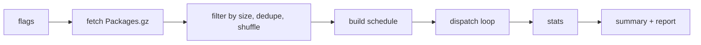

# Zoltraak

Zoltraak is an open-loop HTTP load generator for any server that serves an Ubuntu archive
(a caching proxy, a mirror, or the archive itself). Single static Go binary, stdlib only.

Zoltraak reads the archive's `Packages.gz` indexes, builds a pool of real `.deb` paths, and requests
them on a ramp-then-hold schedule. It reports latency, TTFB, throughput and errors live, and can
write an HTML, JSON and CSV report.

## Contents

- [Quick start](#quick-start)
- [Build locally](#build-locally)
- [How it works](#how-it-works)
- [Examples](#examples)
- [Flags](#flags)
- [Sizing a run](#sizing-a-run)
- [Reports](#reports)
- [Things to know](#things-to-know)

## Quick start

Install the latest release on Linux or macOS (amd64/arm64), without Go or sudo:

```sh
curl -fsSL https://raw.githubusercontent.com/afiffahreza/zoltraak/main/install.sh | sh
export PATH="$HOME/.local/bin:$PATH"

# Fetch only Packages.gz and check the plan; sends no package requests
zoltraak --target http://SERVER/ubuntu --dry-run

# Once the plan fits your link: 5 rps peak, 1m ramp, 1m hold
zoltraak --target http://SERVER/ubuntu --out reports/
```

`--target` (`-t`) is required. Replace `http://SERVER/ubuntu` with the server's archive root.
Always check the dry-run request count and peak bandwidth before sending load.

The installer verifies SHA-256 checksums and installs into `~/.local/bin`. Add the `export` line
to your shell profile if needed. Run the install command again to upgrade. It requires `curl`,
`tar`, and `sha256sum` (Linux) or `shasum` (macOS); inspect the script before running it.

Set `INSTALL_DIR` or `ZOLTRAAK_VERSION` on `sh` to change the destination or pin a release tag.
You can also download binaries from the [releases page](https://github.com/afiffahreza/zoltraak/releases).

## Build locally

Requires Go >= 1.22 and Git:

```sh
git clone https://github.com/afiffahreza/zoltraak.git
cd zoltraak
go build -o zoltraak .
./zoltraak --target http://SERVER/ubuntu --dry-run
```

## How it works



- **Pool.** Downloads `Packages.gz` for the chosen suites, components and architecture, keeps the
  packages inside `--min-size`..`--max-size`, removes duplicates, and shuffles with `--seed`.
- **Schedule.** The rate ramps linearly from 0 to `--rate` over `--ramp`, then holds for `--hold`.
  Total requests = `rate*ramp/2 + rate*hold`.
- **Open loop.** Request n is sent at its scheduled time regardless of how long earlier responses
  take. A slow download only occupies one in-flight slot. If `--max-inflight` slots are all busy,
  the request is *dropped and counted*, never queued.
- **Full downloads.** Every response body is streamed to `io.Discard` (nothing touches disk). The
  body length is checked against the index `Size`, so truncated or corrupt responses show up as
  `size mismatch`.
- **Two workloads.**

  | Mode | Flag | Every request is | Use it for |
  |---|---|---|---|
  | Unique (default) | `--distinct 0` | a different package | cache-miss / cache-exhaustion |
  | Repeating | `--distinct N` | one of N packages, picked at random with repeats | cache-hit |

  With `--distinct N` the sampling is seeded, so `--seed` replays the same request order, and
  slightly fewer than N packages may actually be requested.

The tool cannot see the server's cache. Infer hits and misses from latency and TTFB.

## Examples

```sh
# Defaults: ramp 0->5 rps over 1m, hold 1m, packages <= 1 MiB (450 unique packages)
zoltraak --target http://SERVER/ubuntu

# Full-scale run: 200 rps, 5m ramp, 2m hold, no size cap (54,000 unique packages)
zoltraak --target http://SERVER/ubuntu --rate 200 --ramp 5m --hold 2m --max-inflight 2000 --max-size 0

# Server addressed by IP: send "Host: archive.ubuntu.com" (--host) and fetch the package
# indexes from the real archive (--index) instead of from the server
zoltraak --target http://10.0.0.5/ubuntu --host archive.ubuntu.com \
  --index http://archive.ubuntu.com/ubuntu

# Cache test: 500 distinct packages of 10-200 MB, sampled at random with repeats.
# The first request for each package is a cache miss, later ones can hit.
# --dry-run prints the distinct footprint, i.e. the total size that will be requested.
zoltraak --target http://SERVER/ubuntu --min-size 10M --max-size 200M \
  --distinct 500 --rate 1 --ramp 1m --hold 10m --timeout 5m --max-inflight 100
```

## Flags

Run `zoltraak --help` for the authoritative list. Flags are written `--name`; Go's parser also
accepts `-name`. The only short aliases are `-t` (`--target`), `-i` (`--index`) and `-h` (`--help`).

| Flag | Default | Meaning |
|---|---|---|
| `--target`, `-t` | *(required)* | Archive root URL of the server under test |
| `--index`, `-i` | `--target` | Archive root URL used to fetch `Packages.gz` |
| `--host` | | Override the `Host:` header (does not change where requests go) |
| `--suites` | `noble,noble-updates,noble-security` | Suites to draw packages from |
| `--components` | `main,restricted,universe,multiverse` | Components to include |
| `--arch` | `amd64` | Architecture (arm64, riscv64, ... live on ports.ubuntu.com) |
| `--rate` | `5` | Peak requests per second |
| `--ramp` | `1m` | Linear ramp from 0 to `--rate` |
| `--hold` | `1m` | Time to hold at `--rate` after the ramp |
| `--max-inflight` | `100` | Client-side cap on concurrent requests; excess is dropped and counted |
| `--timeout` | `60s` | Per-request timeout |
| `--min-size` | `0` (no limit) | Skip packages smaller than this |
| `--max-size` | `1M` | Skip packages larger than this (`0` = no limit) |
| `--distinct` | `0` (unique) | Sample from this many distinct packages, with repeats |
| `--seed` | random | Shuffle seed; reuse it to replay the same request order |
| `--interval` | `1s` | Stats print interval |
| `--dry-run` | `false` | Fetch indexes, print the plan, exit without sending load |
| `--out` | | Directory for `report-<UTC time>.{json,csv,html}` |

`--min-size` and `--max-size` take plain bytes (`1048576`) or a suffix. `K`, `M`, `G`, `T` (also
`KiB`, `MiB`, ...) are powers of 1024, so `1M` = `1048576`. `KB`, `MB`, ... are powers of 1000
(`1MB` = `1000000`). Suffixes are case-insensitive and may be fractional (`1.5G`).

## Sizing a run

`--dry-run` prints the plan and these figures without sending load.

- **Requests** = `rate*ramp/2 + rate*hold`. The ramp is linear, so it averages half the rate.
  Package size and `--distinct` do not change this.
- **Packages.** Without `--distinct`, every request is a different package (the pool must have at
  least that many). With `--distinct N`, N packages are kept and each request picks one at random,
  with repeats, so slightly fewer than N may actually be requested.
- **Cache hits.** The first request for a package is a miss; repeats can be hits. More requests per
  distinct package means a higher hit share.
- **Bandwidth** = average package size * `--rate`. The client downloads the whole body on every
  request, hit or miss, so caching on the server never reduces what your machine receives.
- **Distinct footprint** is the total size of the distinct packages requested: the minimum cache
  size needed to keep them all.
- **Concurrency** is about `rate * average latency`. If it reaches `--max-inflight`, requests are
  dropped and counted, not queued.

### Choosing settings for a laptop

Keep peak bandwidth under about 70% of your link, so that you measure the server and not your own
connection. Budget in MB/s is roughly `link Mbit/s / 8 * 0.7`:

| Link | Budget |
|---|---|
| 50 Mbit/s Wi-Fi | ~4 MB/s |
| 100 Mbit/s | ~9 MB/s |
| 1 Gbit/s wired | ~85 MB/s |

Max rate = budget / average package size. Approximate averages measured on noble amd64:

| `--min-size` .. `--max-size` | Avg package | Max rate at 4 MB/s (50 Mbit/s) |
|---|---|---|
| up to 1 MiB (default) | ~0.15 MB | ~25 rps |
| 10 MiB .. 50 MiB | ~20 MB | ~0.2 rps |
| 10 MiB .. 200 MiB | ~44 MB | ~0.1 rps |

Recommended on 50 Mbit/s Wi-Fi: small packages and repeats, for a cache-hit test.

```sh
zoltraak --target http://SERVER/ubuntu --max-size 1M --distinct 200 \
  --rate 10 --ramp 1m --hold 5m --max-inflight 100 --out reports/
```

That is about 3,300 requests at 1-2 MB/s (8-16 Mbit/s, varying with the random package draw) at
peak, comfortably inside the budget. Large packages cannot reach a useful rate on a slow link; for
those, use a wired connection or run from a machine near the server.

## Reports

A live per-interval table and an end-of-run summary always go to stdout. With `--out DIR`, the run
also writes three files named by start time (reruns never overwrite):

| File | Contents |
|---|---|
| `report-<UTC time>.html` | Single self-contained page (inline CSS and SVG, no JS, works offline, follows light/dark mode). Summary cards; charts of request rate (target vs sent/completed/failed), latency (p50/p95/p99, TTFB p95), throughput, and client concurrency/drops; outcome, latency and config tables. A banner flags client-side drops and interrupted runs. |
| `report-<UTC time>.json` | Config (including seed, planned requests/bytes), `interrupted` flag, summary (counts, outcomes by status/error, total and TTFB latency percentiles, bytes) and the full per-interval `timeseries`. |
| `report-<UTC time>.csv` | The same time series, one row per interval, for gnuplot, spreadsheets or Grafana. |

```sh
zoltraak --target http://SERVER/ubuntu --out reports/
jq '.summary' reports/report-*.json
```

Latency percentiles cover successful (HTTP 200, size-matching) responses only; failures are counted
in `outcomes` and `fail_per_s`. The final partial interval is included, so the series sums to the
totals. The report is also written after Ctrl-C (`"interrupted": true`) but not on a second Ctrl-C.

### Live table columns

| Column | Meaning |
|---|---|
| `target` | Planned mean rps in this window |
| `sent/s` | Requests actually sent; should track `target` |
| `infl` | Concurrent in-flight requests |
| `drop` | Cumulative client-side drops. If non-zero, the load generator, not the server, was the bottleneck |

## Things to know

- **Bandwidth is the real limit.** Defaults (5 rps, packages <= 1 MiB) peak at about 5 MB/s.
  200 rps of average-size debs is roughly 1 Gbit/s or more. On a laptop or Wi-Fi the link saturates
  first and latencies then measure your uplink, not the server. Use `--max-size` to cap
  per-request size.
- **Pool size.** Without `--distinct`, unique-per-request needs `rate*ramp/2 + rate*hold` packages.
  The default suites (noble, noble-updates, noble-security; all components) give well over 54k for
  amd64; add suites such as `jammy,jammy-updates` for longer runs. With `--distinct N` only N
  packages in the size range are needed. The tool refuses to start if the pool is too small.
- **Reruns.** The shuffle is random per run, so repeated runs overlap and the cache may already be
  warm for earlier packages. Use a different `--suites`/`--seed` or flush the cache between runs.
- **Indexes** are fetched from `--target` by default, which warms those index objects only. Use
  `--index` (`-i`) to fetch them from elsewhere.
- **Transport.** HTTP/1.1 with keep-alive. The `HTTP_PROXY`/`HTTPS_PROXY` environment variables are
  ignored on purpose, and `Accept-Encoding: gzip` is not sent.
- **Ctrl-C** stops dispatch, drains in-flight requests and prints the summary. A second Ctrl-C
  aborts.
